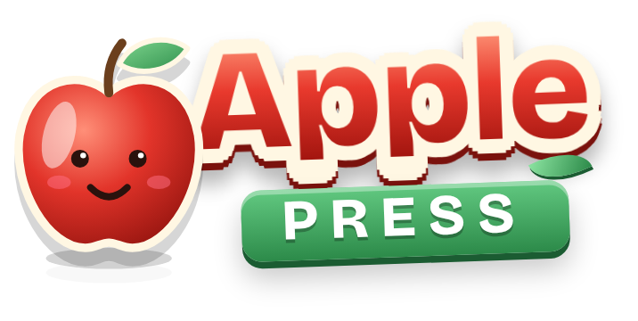
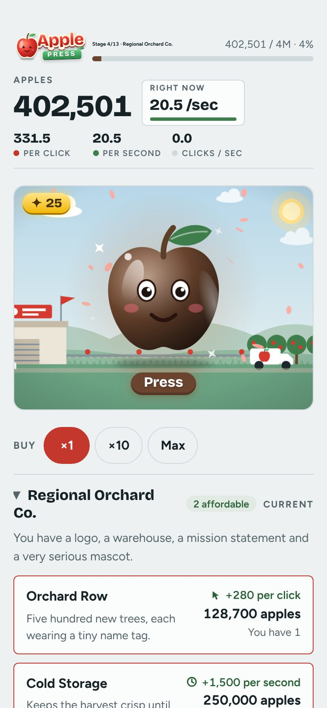
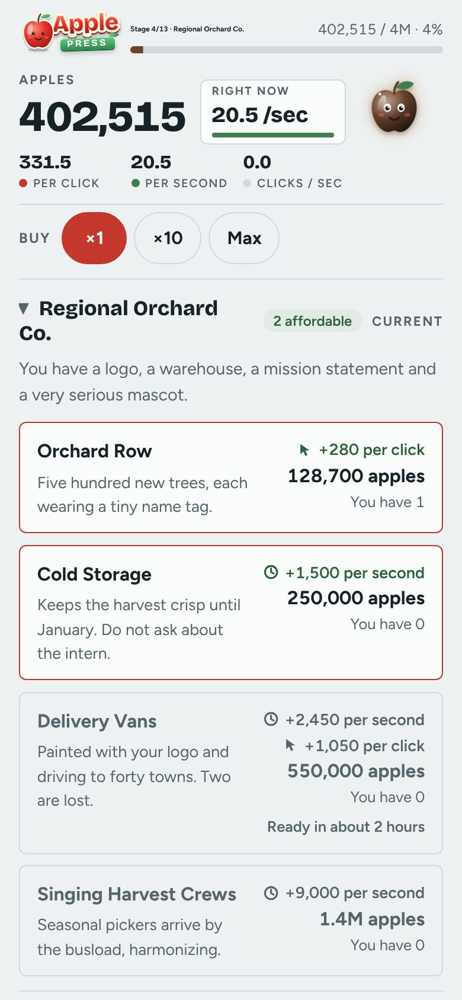
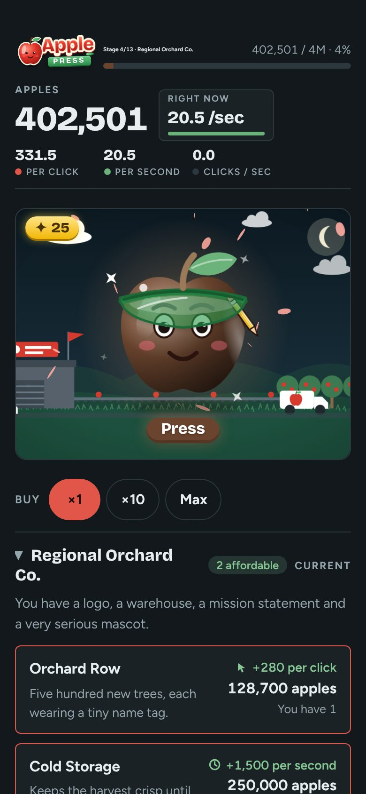
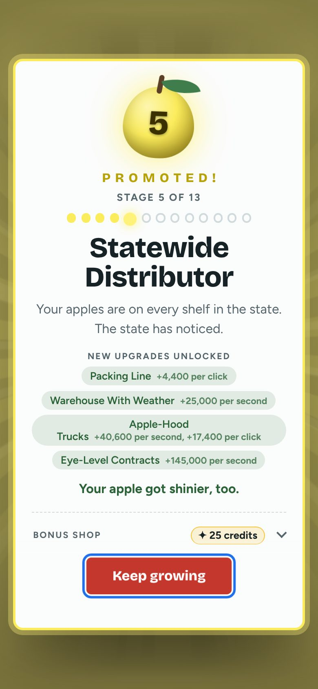
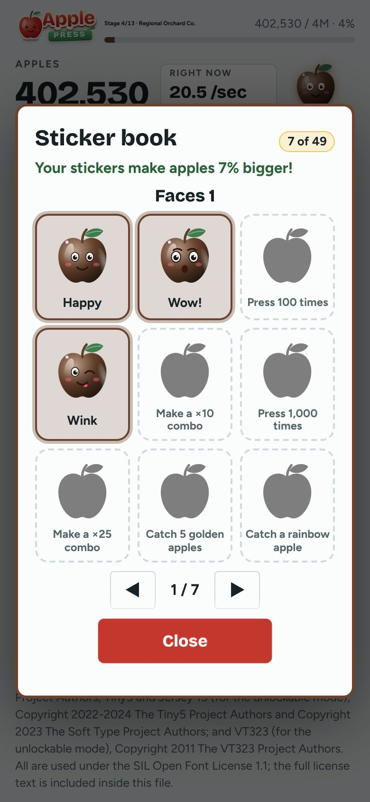

# Apple Press

**A gentle clicker for kids. Tap a big cartoon apple and grow a backyard orchard into something far bigger.**

[**Play it here**](https://lfcfoundry.github.io/apple-press/play/) · [**About**](https://lfcfoundry.github.io/apple-press/) · [**Source code**](https://github.com/lfcfoundry/apple-press)

         

## What it is and how it works

Apple Press is a free clicker game for kids in a single web page. Tap the apple to pick apples, buy upgrades, and move through stages that each bring a promotion party, a new animated scene and new upgrades. The whole game, with scenes, fonts and code, is one HTML file. It runs with no server and keeps progress in your browser, so once the page is open, or saved as one file, it needs no internet. New players get a short guided tour the first time they play, and it can be skipped.

<table>
<tr>
<td align="center" valign="top"> Play</td>
<td align="center" valign="top"> Upgrades</td>
<td align="center" valign="top"> Dark mode</td>
</tr>
</table>

## Why it exists

A gentle clicker for children and the grown-ups who sit with them: free, with no ads, purchases or accounts, no sounds, no timers or streaks, and nothing to trade. It also tests how much game fits in one small file anyone can save, send to a friend and open offline.

## Highlights

| Built for kids | 13 stages | No sound | Send it to a friend |
|---|---|---|---|
| Big tap targets, no timers or streaks, and a Grown-ups door in front of links. | A first adventure of six stages, then a longer journey, with a sticker book of 49 stickers. | No sound: a visual and tactile game with less stimulation for sensory challenges. Calm effects tone down motion. | One file, or two smaller copies for messages and email. Double-click to open. |

## Safe, free and open

Apple Press is made for children, so it is built to be easy to trust.

- **No ads.** Nothing in the game tries to sell, show or sneak in anything.
- **No accounts.** No sign-up, no log-in, no email, no age questions. Open it and play.
- **No data sent anywhere.** Progress stays in your own browser. The game sends nothing to any server, and a grown-up can check that in the open code.
- **No microtransactions.** Nothing to buy, no coins to top up and no timers that push a purchase. Every upgrade is earned by playing.
- **Fully open source.** The whole game is free to read, copy and change under the MIT License.
- **Nothing to install.** No download, no installer and no administrator rights. Open the page in your browser and play. No computer know-how needed: if you can tap an apple, you can play.
- **Works offline.** Once the page is open, or saved to your device as one file, the game needs no internet at all, so it plays on a plane, in a car or anywhere with no signal.
- **Single player.** One child, one apple. There is no chat, no friends list, no leaderboard and no way to meet strangers.
- **Any modern browser, most standard screens.** Tested in Chromium, Firefox and WebKitGTK, on screens from a small 320-pixel-wide phone up to a 1920-pixel-wide computer, with no sideways scrolling.

## 🚧 Status

> **BETA: for testers only.** This is a work-in-progress version of the game that friends and family are helping to test. Things will change, and some things may be rough. Your progress is saved in your own browser, and a new update could occasionally change how the game plays.

## ✅ At a glance

- **For children and families.** No ads, no purchases, no accounts.
- **Works offline.** Once the page is open, or saved as one file, no internet is needed. Open it in any modern browser on a phone, tablet or computer.

## 📦 Sending the game to a friend

The whole game is one file, and there are two smaller copies of the same game for sending by message or email. Both open by double-click and work offline, with no internet needed.

| Copy | Size (smaller is better) | Opens in (smaller is better) |
|---|---|---|
| [apple-press-small.html](https://lfcfoundry.github.io/apple-press/apple-press-small.html) | 295,211 bytes | about 40 to 56 ms |
| [apple-press-smallest.html](https://lfcfoundry.github.io/apple-press/apple-press-smallest.html) | 210,844 bytes (28% smaller) | about 97 to 99 ms |

The regular page is 746,516 bytes. Opening times were measured on an earlier build (before the Firefox-only Disco Fever picture was added) on one test computer in four browsers (GNOME Web was dropped from testing on 2026-10-24); a phone may take longer.

If the game ever feels slow or breaks on your device, tap five times quickly in the top-left corner of the page. A small panel opens with **Save speed report** and **Save error log**; each saves one small file on your device that you can share. Nothing is sent anywhere. (Made with the shared [field-report](https://github.com/lfcfoundry/js-modules/tree/main/modules/field-report) module.)

## ⚡ How fast it runs

Measured on build 2026.10.23.2114 (the later swap of the Grown-ups door and the tour to shared code was timed separately: scrolling was no slower) on one test computer, one browser at a time: Firefox 158.0, ungoogled Chromium 155.0.8059.39-1 and WebKitGTK 2.52.6. Tapping the apple at a late stage with lots of effects on screen, in frames per second (higher is better): Chromium 120, Firefox about 70 to 95 (it varies from run to run), WebKitGTK 23 to 26. The first game picture appears after about 100 to 175 ms (smaller is better). The game's own scripts use about 6 MB of memory. On a slow device the game steps its effects down by itself and holds the background scene still. A phone may be slower.

## 🎮 How it plays

Each press earns apples. Upgrades add apples per press and per second. Every stage brings a promotion party, a new animated scene, a new apple color and new upgrades. A first adventure ends after six stages; after that, the full 13-stage journey opens up, and the most dedicated players may find there is more to discover.

<table>
<tr>
<td align="center" valign="top"> A promotion party when a new stage opens</td>
<td align="center" valign="top"> The sticker book: 49 to collect</td>
</tr>
</table>

## 🧒 Testing with a child?

There is a one-page [playtest card](PLAYTEST-CARD.md) for a grown-up who sits with a child while they try the game.

## ⭐ What's in the game

- **A lively apple:** about 22 moods, eyes that follow your finger, and a spin now and then to show off. 
- **Upgrades that double:** own 10, 25 or 50 of the same upgrade and every copy gets twice as strong.
- **Combos:** press quickly to build a combo and watch the counter heat up from ember red to white-hot.
- **Special apples:** golden, crystal, jade, rainbow, comet, cosmic and a few secret kinds fly across the scene. Catch them for bursts of apples and bonus credits. In the later stages, watch out for the poison apple!
- **Shops and collectibles:** a bonus shop, Extras that open as you play again, hats and costumes, scenery friends (a cat, a dog, a garden gnome, a friendly UFO and more), and a sticker book with 49 stickers to earn.
- **Your own story:** the ending opens a picture storybook of your game.
- **Looks and settings:** light and dark modes, Full, Lite and Calm effects (picked automatically on slower devices), a title screen that dresses up for the seasons and more than 40 holidays, and an unlockable mode for players who go the distance.
- **Safe saving:** progress autosaves in your browser, keeps a backup copy, and can be copied or downloaded to move to another device.
- **A quick tour:** new players get a friendly guided look at the page the first time they play, in short steps with simple words that young children can follow. It can be skipped, and opened again from the How to play button.
- **Built for kids:** big tap targets, no timers or streaks, and nothing to trade.

 It fills a bigger screen too

## ♿ Accessibility

- **No sound, by design.** There are no sounds or music, so the game is a visual and tactile experience (the apple squishes under a finger, things sparkle and move) with less stimulation for players with sensory challenges. There is no volume to manage, and parents have heard enough beeping for one day.
- **Flash-safe celebrations.** The promotion celebrations are checked against flash-safety limits.
- **Hold to press.** Hold the apple down and it keeps pressing for you, which helps tired hands and younger players who find rapid tapping hard. It can be switched off in the footer.
- **Gentler effects.** The Calm effects setting tones down motion, and the game picks a lighter setting by itself on slower devices.
- **Calm on request.** If your device asks for reduced motion, the game offers a one-tap switch to Calm and remembers your answer. It never switches on its own.
- **Presses at once.** The apple counts the moment it is touched, not when the finger lifts.
- **A Grown-ups door.** Start over and the links to other games sit behind a hold-then-drag door that young children are unlikely to pass. It is a speed bump for small hands, not a lock.

## 💡 Playing tips

- Phones play best held upright. Tablets can be played sideways.
- If the game feels slow on an older device, try the Lite or Calm effects setting.
- Clearing your browser's site data erases your saved progress, so use the save backup first if you want to keep it.

## 🧪 Testing and feedback

Please tell JNFoo what you find: anything confusing, anything too hard or too slow, anything that looks or runs badly, and which device and browser you used. If you have a GitHub account you can also open an issue on this page.

The latest release was tested in Firefox 158.0, ungoogled Chromium 155.0.8059.39-1 and WebKitGTK 2.52.6, one at a time (listed at the top of [changelog.md](changelog.md)). Every test from 2026-10-24 on covers these three browsers (GNOME Web 46.5 was part of earlier tests).

## 🆕 What's new

See [changelog.md](changelog.md) for a short, plain list of what changed, newest first. Developers: [changelog-dev.md](changelog-dev.md) has the same changes in three depths (Quick, Details, Deep).

## More from LFC Foundry

- [Fancy Banana](https://github.com/lfcfoundry/fancy-banana): a one-tap flying-banana arcade game ([play](https://lfcfoundry.github.io/fancy-banana/))
- [Pineapple Defense](https://github.com/lfcfoundry/pineapple-defense): a flick-to-throw pineapples-at-penguins game ([play](https://lfcfoundry.github.io/pineapple-defense/))
- [JS-modules](https://github.com/lfcfoundry/JS-modules): free (MIT) code pieces taken from this game ([demos](https://lfcfoundry.github.io/JS-modules/))

## 🙏 Credits and attributions

- **Fonts.** Bricolage Grotesque (Copyright 2022 The Bricolage Grotesque Project Authors) and Figtree (Copyright 2022 The Figtree Project Authors), plus a few more listed in the notice inside the game file. All are used under the SIL Open Font License 1.1, and the full license text is included inside the game file.
- **Shared code.** Several parts of the game (saving and loading, the small apple's flight, the curtain painter, the Grown-ups door, the first-time tour, the hidden speed and error buttons, the slow-moment note, test isolation) come from [JS-modules](https://github.com/lfcfoundry/JS-modules), which is MIT-licensed.
- **Smallest copy.** [apple-press-smallest.html](https://lfcfoundry.github.io/apple-press/apple-press-smallest.html) is packed with LZMA, the compression method of the 7-Zip program by Igor Pavlov, and unpacked by a 4,087-byte WebAssembly helper from JS-modules.

## © Ownership

Copyright (c) 2026 LFC Foundry. Apple Press is open under the MIT License (see `LICENSE`), with a branding notice: the name "LFC Foundry" and its project identities are reserved, so a fork, a significant modification or a commercial redistribution must change the public product name and branding. The fonts are used under the SIL Open Font License.
